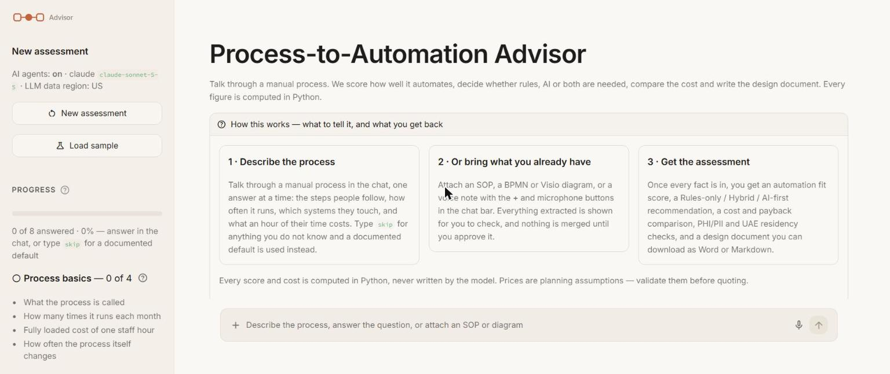
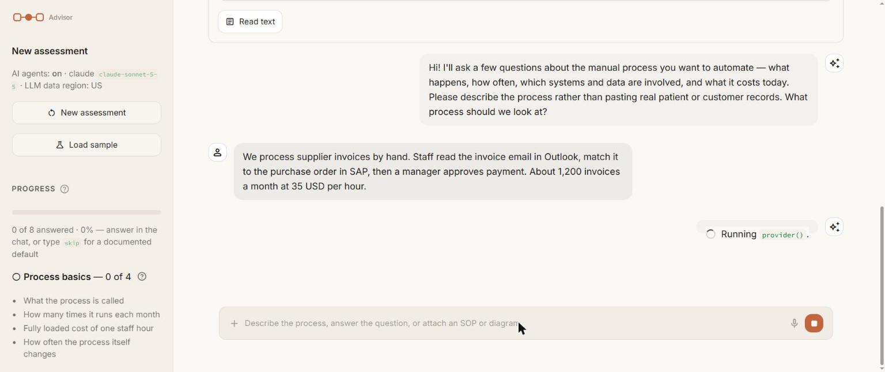
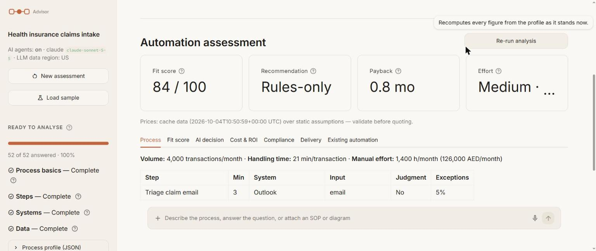
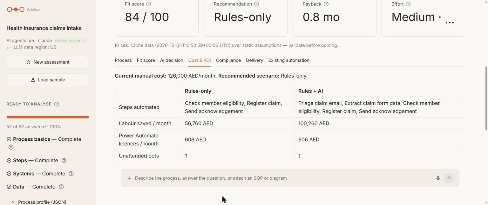
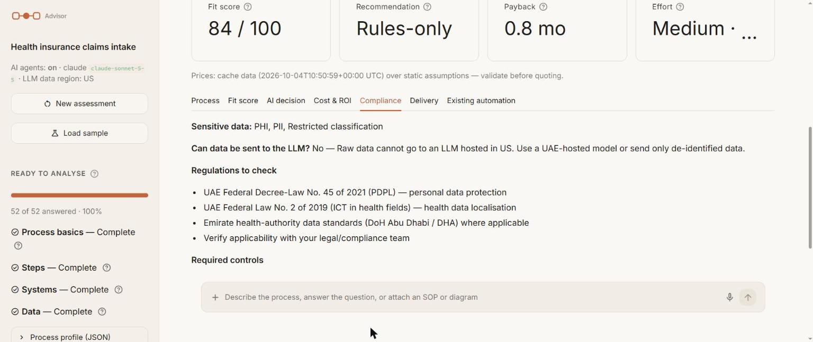

# User manual

A complete guide to the Process-to-Automation Advisor: what it asks you, what it works out, and how
to read what it gives back.

**Contents**

1. [Before you start](#1-before-you-start)
2. [The screen](#2-the-screen)
3. [Describing your process](#3-describing-your-process)
4. [Bringing in what you already have](#4-bringing-in-what-you-already-have)
5. [Reading the assessment](#5-reading-the-assessment)
6. [The design document](#6-the-design-document)
7. [Live prices and currency](#7-live-prices-and-currency)
8. [Your Microsoft 365 tenant](#8-your-microsoft-365-tenant)
9. [Working without an API key](#9-working-without-an-api-key)
10. [Troubleshooting](#10-troubleshooting)

---

## 1. Before you start

Install and run:

```powershell
python -m venv .venv
.venv\Scripts\python -m pip install -r requirements.txt
copy .env.example .env
.venv\Scripts\streamlit run app.py
```

The app opens at `http://localhost:8501`.

**You do not need an API key.** With `LLM_API_KEY` empty the app runs in offline mode: a rule-based
interviewer asks the questions and a template writer produces the document. Everything else — the
scoring, the costs, the compliance checks, the imports, the live prices — is identical either way.

> **Do not paste real patient or customer records.** Describe the process, not the data. The app
> asks about *categories* of data (does it contain patient health information?), never the data
> itself.

---

## 2. The screen



| Area | What it is |
|---|---|
| **Left sidebar** | Your progress. Each group — process basics, steps, systems, data — shows how many answers are in, with an information icon explaining what is expected and why it matters. |
| **Middle** | The conversation. Your turns appear on the left, the advisor's on the right. |
| **Bottom bar** | Where you type. The **+** attaches a file, the microphone records, and the arrow sends. While a reply is being written the arrow becomes a stop button. |
| **How this works** | A three-card summary, open the first time, explaining what to tell it and what you get back. |

The assessment does not appear until every fact has been collected. This is deliberate: a greyed-out
button you cannot use is noise. When the last answer lands, the results appear by themselves.

---

## 3. Describing your process

Type a plain description to begin. You do not have to be precise or complete:

> We process supplier invoices by hand. Staff read the invoice email in Outlook, match it to the
> purchase order in SAP, then a manager approves payment. About 1,200 invoices a month at 35 USD
> per hour.



The advisor pulls out what it can — here, three steps, the volume, the hourly cost, and two systems —
tells you what it assumed, then asks only for what is still missing.

### What it needs from you

| Group | Why it matters |
|---|---|
| **Process basics** | The name, how many times it runs each month, the fully loaded cost of a staff hour, and how often the process itself changes. Volume and cost drive the savings; instability is the main reason automations break. |
| **Steps** | For each step: how long it takes, which system it uses, what kind of input it handles, whether it needs human judgment, whether the rules are written down, and the exception rate. |
| **Systems** | Whether each system has an API or a connector, and how often its screens change. A system with no API must be driven through its user interface, which is far more fragile. |
| **Data** | Whether the process touches patient health data, personal data, and whether that data must stay in the UAE. |

### Useful things you can type

| You type | What happens |
|---|---|
| `skip` (or "don't know") | A documented conservative default is used and recorded as an assumption. |
| `add step Reconcile payment` | Adds a step. |
| `remove step 2` | Removes a step by number or name. |
| `step Register claim takes 4 min` | Corrects a single fact. |
| `summary` | Shows everything captured so far. |
| `actually it's 2,000 a month` | Corrections are understood mid-conversation. |

Nothing is locked in. Change any answer later and the assessment recalculates.

---

## 4. Bringing in what you already have

Use the **+** button in the chat bar, or the panel above the conversation.

| Source | What is read | What is not |
|---|---|---|
| **Pasted text** (SOP, work instruction) | Steps, minutes, systems, volume, staff cost, currency, PHI/PII/UAE flags | — |
| **BPMN 2.0** (`.bpmn`, `.xml` from Camunda, Signavio, Bizagi) | Step order, lanes, systems, approvals, decisions | Times and volumes — diagrams do not carry them, so you are asked |
| **Visio** (`.vsdx`) | The same as BPMN, from the shape text | Group shapes are not expanded |
| **Voice** (microphone, or an audio file) | A transcript, read like pasted text | — |

**Nothing is merged until you approve it.** Every import shows a preview listing each step it found
and every assumption it made. Check it, then click **Merge into profile** or **Discard import**. If
you already named the process, your name is kept.

Voice needs a one-time install of the local speech-to-text model:

```powershell
.venv\Scripts\python -m pip install -r requirements-voice.txt
```

The first transcription downloads about 150 MB; after that it works offline. Audio never leaves your
machine. Without it, the microphone button is simply hidden.

---

## 5. Reading the assessment



Four headline numbers, then seven tabs. Every one of these figures is calculated in Python. The
language model never does arithmetic — it only writes prose.

### The headline numbers

| Number | How to read it |
|---|---|
| **Fit score** (0–100) | How well this process suits automation. 75+ is a strong candidate; 50–74 works with a person in the loop; 30–49 means standardise the process first; below 30 is not recommended yet. Built from rules clarity (25), volume (20), stability (15), data quality (20) and ROI (20). |
| **Recommendation** | **Rules-only**, **Hybrid** or **AI-first**. AI is only recommended where it earns its place. |
| **Payback** | How many months until the build cost is recovered. |
| **Effort** | A size band and a build-day estimate. |

### The tabs

- **Process** — the steps as captured, with volume and current manual effort.
- **Fit score** — the score broken into its five components, so you can see what is dragging it down.
- **AI decision** — which steps show AI signals (unstructured input, scanned documents, email, voice,
  judgment) and why the recommendation landed where it did. Approval steps are deliberately excluded:
  a human approval is not an AI candidate.
- **Cost & ROI** — the comparison below.
- **Compliance** — PHI/PII and UAE data residency.
- **Delivery** — which steps need a person in the loop, the recommended tool for each step, the
  effort estimate and the maintenance risk.
- **Existing automation** — Power Automate flows you already own that may cover some of these steps.

### Cost and ROI



Two scenarios side by side: **Rules-only**, where AI-ish steps stay manual, and **Rules + AI**, where
they are automated with a review step. Each shows labour saved, licence cost, running cost, payback
and three-year value.

> **These are planning figures, not a quote.** Azure prices are public pay-as-you-go list prices, not
> your negotiated or Enterprise Agreement rates. Everything else comes from the editable assumptions
> in `advisor/data/pricing_assumptions.json`. Check them against current Microsoft and Anthropic
> pricing before showing the result to anyone.

### Compliance



The check covers UAE Federal Decree-Law No. 45 of 2021 (PDPL), UAE Federal Law No. 2 of 2019 on ICT
in health fields, and emirate-level health-authority standards.

The important line is **"Can data be sent to the LLM?"**. If the process holds data that must stay in
the UAE and your model is hosted elsewhere, the answer is no, and the AI recommendation falls back to
Rules-only with the reason stated. Choosing a UAE-hosted runtime model in the sidebar changes that
answer: pick a `(uaenorth)` model and AI becomes available for UAE-resident patient data.

> This is a prompt for a conversation with your legal team, not legal advice.

---

## 6. The design document

Click **Generate design document** for a full write-up: background, the process as captured, the
recommendation and why, costs and ROI, existing automation, compliance, the delivery plan, risks and
next steps.

Download it as **Markdown** or **Word (.docx)**.

The writer produces only the narrative. Every table and number is inserted afterwards by Python, so
the document cannot disagree with the analysis.

---

## 7. Live prices and currency

**Refresh live prices & FX** in the sidebar fetches, with no API key and no account:

- exchange rates from open.er-api.com, falling back to Frankfurter
- Azure OpenAI and Document Intelligence list prices from the public Azure Retail Prices API

Results are cached in `advisor/data/live_cache.json`. On startup a cache less than a day old is used
with no network call at all. **The app never fetches anything unless you click that button.**

Power Automate licence costs and Anthropic token prices have no public price API, so they remain
static assumptions.

**AI runtime model** selects the model whose token prices are used in the cost estimate, and it also
determines the data region used by the compliance check.

---

## 8. Your Microsoft 365 tenant

Optional, and it needs no credentials — you export the files yourself.

- **Power Automate exports** (`.zip` packages, solution `.zip` files or flow `.json`): the
  **Existing automation** tab lists steps that flows you already own may cover. Matching is by word
  overlap, so treat each one as a lead to check, not a fact.
- **Licence CSV** (from the Microsoft 365 admin centre, or Graph `subscribedSkus`): spare Power
  Automate Premium and Process licences and AI Builder credits are deducted from each scenario.

---

## 9. Working without an API key

| Job | Without a key | With a key |
|---|---|---|
| Interview | Guided interviewer — parses your description, then asks for what is missing | Claude interviewer, free conversation |
| Design document | Template writer — same structure, written from the analysis | Claude writer |
| Everything else | Identical | Identical |

To switch the AI on, put the key in `.env`:

```
LLM_API_KEY=sk-ant-...
LLM_PROVIDER=claude
LLM_MODEL=claude-sonnet-5-5
```

Restart the app. The banner disappears and the sidebar shows **AI agents: on**.

If the key is wrong or the network fails mid-conversation, the app says so, switches to the offline
agents and carries on — you do not lose the interview. Fix the key and restart, or click
**Retry AI agents** after a temporary network problem. `LLM_PROVIDER=offline` forces offline mode
even when a key is present.

---

## 10. Troubleshooting

| Symptom | Cause and fix |
|---|---|
| "The AI interviewer failed (Claude API key is missing or invalid)" | The key in `.env` is wrong, expired, or has no credit. Note that the sidebar can show "AI agents: on" simply because a key is *present* — it is not verified until the first call. Check the key at console.anthropic.com. |
| Microphone button missing | `faster-whisper` is not installed. Run `pip install -r requirements-voice.txt`. |
| Browser says "An error has occurred" when recording | Microphone permission. Allow it for `localhost` in the site settings, check Windows privacy settings, and close other apps using the microphone. You can upload an audio file instead. |
| "Unknown currency" error | The currency code has no exchange rate. Add one to `fx_to_usd` in `advisor/data/pricing_assumptions.json`, or refresh live FX. |
| The assessment does not appear | Facts are still missing. The sidebar lists exactly which. Type `skip` to accept a default. |
| Prices look wrong | They are planning placeholders. Edit `advisor/data/pricing_assumptions.json`. |
| The analysis looks stale after a change | It clears itself whenever the profile changes. Click **Re-run analysis**. |
